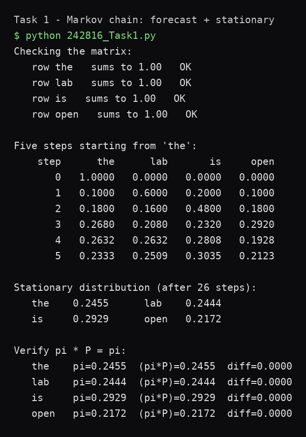
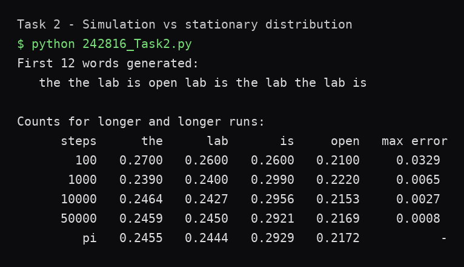
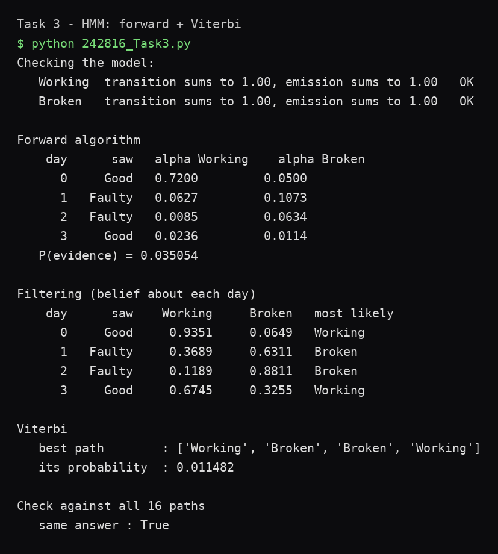

# AI Lab 06 — Markov Models

**CS344L — Artificial Intelligence Lab · Week 6 · BSCS, Air University**

Lab 05 constrained the search; this lab reasons **under uncertainty**. A **Markov chain** is a sequence where the next state depends only on the current one — the transition matrix `P` holds `P(next | current)`. Pushing a belief through `P` repeatedly gives the **forecast**; pushing it forever gives the **stationary distribution π** (where `πP = π`). A **hidden Markov model** adds a second layer: the states are invisible and only noisy observations reach us — the **forward algorithm** sums over all hidden paths, **Viterbi** finds the single best one.

Three programs, plain Python 3, standard library only — no packages installed.

## What's inside

| Task | File | What it does |
|---|---|---|
| 1 | `242816_Task1.py` | 4-word Markov chain: row validation, `next_step()` (two loops), forecast table for steps 0–5, stationary distribution by power iteration (tolerance 1e-10), `πP = π` verification |
| 2 | `242816_Task2.py` | Monte-Carlo simulation of the same chain: `pick()` via `rng.random()` + running total, `simulate()` walking the transition rows, count fractions for 100 → 50,000 steps vs π (fresh `Random(42)` per row) |
| 3 | `242816_Task3.py` | HMM of a factory machine (Working/Broken → Good/Faulty items): forward algorithm, per-day filtering beliefs, Viterbi with back-pointers, brute-force check over all 2⁴ = 16 hidden paths |

The submitted lab report (`242816_lab_06.docx`, also as PDF) contains the answers to Q1–Q6 and the run-window screenshots.

## Verified results

**Task 1 — forecast from 'the':**

| step | the | lab | is | open |
|---|---|---|---|---|
| 0 | 1.0000 | 0.0000 | 0.0000 | 0.0000 |
| 1 | 0.1000 | 0.6000 | 0.2000 | 0.1000 |
| 2 | 0.1800 | 0.1600 | 0.4800 | 0.1800 |
| 3 | 0.2680 | 0.2080 | 0.2320 | 0.2920 |
| 4 | 0.2632 | 0.2632 | 0.2808 | 0.1928 |
| 5 | 0.2333 | 0.2509 | 0.3035 | 0.2123 |

**Stationary distribution (after 26 steps):** the 0.2455, lab 0.2444, is 0.2929, open 0.2172 — and pushing π through `P` once more changes nothing (diff 0.0000).

**Task 2 — simulation vs theory:**

| steps | the | lab | is | open | max error |
|---|---|---|---|---|---|
| 100 | 0.2700 | 0.2600 | 0.2600 | 0.2100 | 0.0329 |
| 1000 | 0.2390 | 0.2400 | 0.2990 | 0.2220 | 0.0065 |
| 10000 | 0.2464 | 0.2427 | 0.2956 | 0.2153 | 0.0027 |
| 50000 | 0.2459 | 0.2450 | 0.2921 | 0.2169 | 0.0008 |
| π | 0.2455 | 0.2444 | 0.2929 | 0.2172 | — |

First 12 words: `the the lab is open lab is the lab the lab is`

**Task 3 — HMM** (evidence Good, Faulty, Faulty, Good):

| day | saw | Working | Broken | most likely |
|---|---|---|---|---|
| 0 | Good | 0.9351 | 0.0649 | Working |
| 1 | Faulty | 0.3689 | 0.6311 | Broken |
| 2 | Faulty | 0.1189 | 0.8811 | Broken |
| 3 | Good | 0.6745 | 0.3255 | Working |

P(evidence) = 0.035054 · Viterbi best path = Working → Broken → Broken → Working (0.011482, i.e. **32.8%** of the total) · brute force over all 16 paths agrees.





## Key observations

- **Step 1 is just the 'the' row.** Starting 100% on 'the' means the first forecast step copies `P(·|the)` out of the matrix: lab 0.60, open 0.10.
- **π forgets where it started.** From 'open' the first three steps look completely different, but the chain mixes to the identical stationary distribution — π is a property of the matrix, not the start.
- **Error falls, never to zero.** 0.0329 → 0.0065 → 0.0027 → 0.0008: a simulation is a finite sample of a random process, and π is the limit it approaches. Remove the seed and the 12 words change every run, but the 50,000-step row still hugs π.
- **Day 3 swings back but not all the way.** A Good item after two Faulty ones moves the belief to Working 0.6745 (Good is 0.90 vs 0.25 likely), yet it can't return to day 0's 0.9351 — the faulty evidence lingers, and Broken stays broken 70% of the time.
- **The best path is not a certainty.** Viterbi's path carries only 32.8% of P(evidence); the other 67% lives in the remaining 15 paths. Forward sums (asks about the evidence), Viterbi maxes (asks about one path).

## How to run

```bash
python 242816_Task1.py
python 242816_Task2.py
python 242816_Task3.py
```

## Project structure

```
hussnain-ai-lab-6/
├── 242816_Task1.py
├── 242816_Task2.py
├── 242816_Task3.py
├── screenshots/
│   ├── run_task1.png
│   ├── run_task2.png
│   └── run_task3.png
├── 242816_lab_06.docx        # submitted lab report (Q1–Q6 + screenshots)
├── 242816_lab_06.pdf
└── README.md
```

---
*BSCS coursework — Air University, Islamabad. Lab 05 (constraint satisfaction) lives in [hussnain-ai-lab-5](https://github.com/hussnainahmedd/hussnain-ai-lab-5).*
